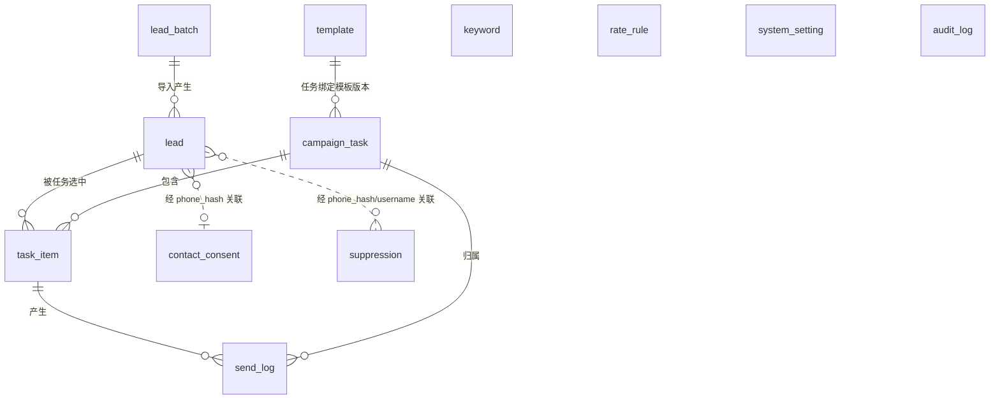
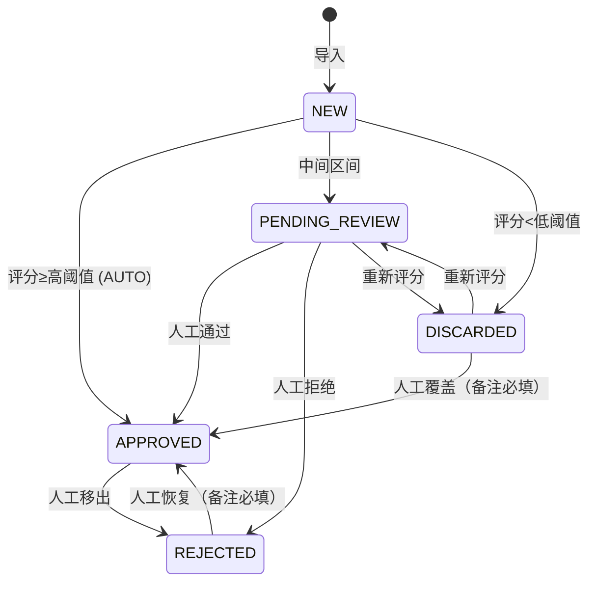
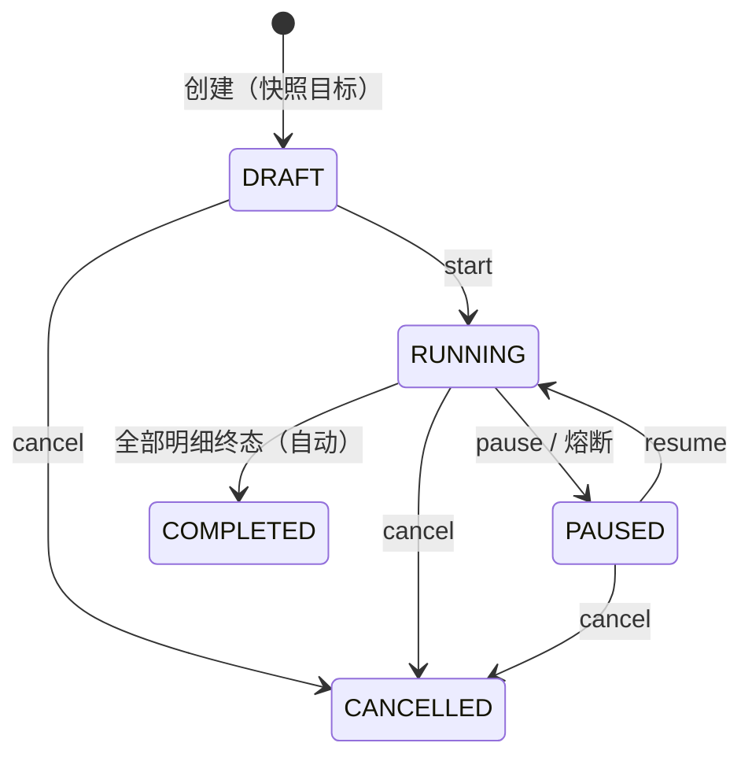
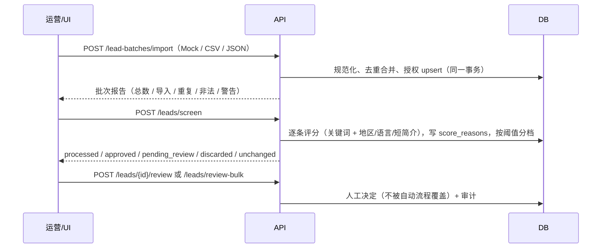
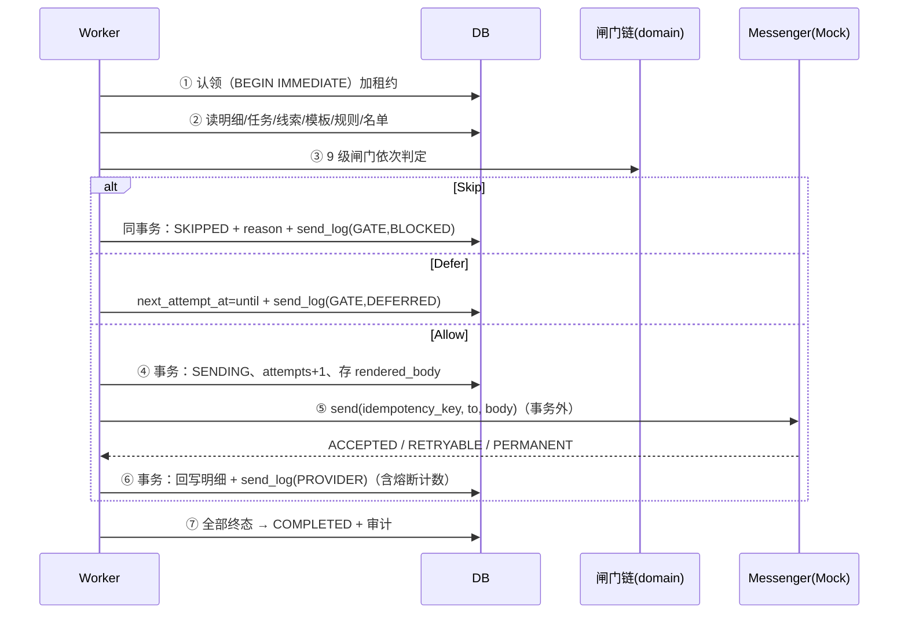

# 数据模型与核心流程

> 面向交付与答辩的整理版；**权威定义**见 `specs/03-data-model.md` 与 `specs/02-architecture.md`。
> 共 12 张表；主键均为自增整数；所有时间以 UTC 存储、API 输出 ISO-8601 带 `Z`。

## 1. ER 图



## 2. 表清单

| 表 | 作用 | 关键列与约束 |
|---|---|---|
| `keyword` | 评分关键词 | `term`（规范化）、`kind`（POSITIVE/NEGATIVE）、`weight`、`enabled` |
| `lead_batch` | 每次导入的批次与报告 | `source_type/source_name`、`total_rows/imported/duplicates/invalid/warnings`、`errors`(JSON) |
| `lead` | 线索 | `username` 唯一；`phone_enc`（Fernet）/`phone_hash`（HMAC，部分唯一索引）/`phone_masked`；`status`、`score`、`score_reasons`、`top_keyword`、`decision_source`、`reviewed_*` |
| `contact_consent` | 号码维度的授权 | `phone_hash` 唯一；`status`（GRANTED/REVOKED）、`source`、`evidence_ref`、`granted_at` |
| `suppression` | 黑名单 / 退订 | `type`（BLACKLIST/UNSUBSCRIBE）+（`phone_hash` 或 `username`）部分唯一索引；`reason`、`source` |
| `template` | 版本化模板 | `name`+`version` 唯一、`body`、`language`、`status`（DRAFT/APPROVED/DISABLED）；`CHECK(version>=1)` |
| `rate_rule` | 频控规则 | `scope`（GLOBAL/PER_RECIPIENT）、`window_seconds`、`max_count`、`enabled` |
| `system_setting` | 运行期设置 | `key` 主键、`value`(JSON)、`updated_by`；26 个注册键，类型与范围校验 |
| `campaign_task` | 触达任务 | `template_id`、`status`、`selection`(JSON 快照条件)、`total_items`、`pause_reason`、`consecutive_failures`、各时间戳 |
| `task_item` | 任务明细（状态机单位） | `UNIQUE(task_id, lead_id)`；`idempotency_key` 全局唯一；`phone_hash/phone_masked` 快照；`status`、`attempts`、`next_attempt_at`、租约 `locked_by/locked_at`、`reason_code`、`provider_message_id`、`last_error_*`、`rendered_body` |
| `send_log` | 每次闸门决策 / Provider 调用一行 | `phase`（GATE/PROVIDER/RECEIPT）、`outcome`、`reason_code`、`attempt_no`、`latency_ms`、`detail`(JSON)、`phone_masked` |
| `audit_log` | 审计（只追加） | `actor`、`action`、`entity_type/entity_id`、`before/after`（已脱敏）、`request_id`、`prev_hash/hash`；触发器拒绝 UPDATE/DELETE |

## 3. 状态机

### 3.1 线索 `lead.status`



人工产生的 `APPROVED` / `REJECTED` 不会被重新评分覆盖；自动评分只作用于 `NEW` / `PENDING_REVIEW` / `DISCARDED`。

### 3.2 任务 `campaign_task.status`



`start` 对 `RUNNING` 是幂等 no-op，对其他非法状态返回 409；任务完成由 Worker 在明细全部终态后自动判定。

### 3.3 明细 `task_item.status`

```mermaid
stateDiagram-v2
  [*] --> PENDING
  PENDING --> SENDING: 闸门放行，attempts+1
  RETRY_WAIT --> SENDING: 到期且放行，attempts+1
  SENDING --> SENT: Provider 受理
  SENDING --> RETRY_WAIT: 可重试失败 / 租约过期回收
  SENDING --> FAILED: 永久失败 / 尝试耗尽
  SENT --> DELIVERED --> READ: 回执（只前进）
  SENT --> READ: 跳级回执
  SENT --> FAILED: 失败回执
  DELIVERED --> FAILED: 失败回执
  PENDING --> SKIPPED: 闸门拦截 / 任务取消
  RETRY_WAIT --> SKIPPED: 闸门拦截 / 任务取消
```

- 闸门「延迟」（频控 / 静默时段）**不改变状态**，只更新 `next_attempt_at`，不消耗 `attempts`。
- 任务完成判定：不存在 `PENDING` / `SENDING` / `RETRY_WAIT` 明细。

### 3.4 模板 `template.status`

`DRAFT → APPROVED → DISABLED`；`DRAFT` 可直接 `DISABLED`。`APPROVED` 的 `body` 不可修改，修改等于新建 `version+1`（`DRAFT`）。

## 4. 数据不变量

| 编号 | 不变量 | 保障 |
|---|---|---|
| INV-1 | 同一任务同一线索至多一条明细 | `UNIQUE(task_id, lead_id)` |
| INV-2 | 幂等键全局唯一 | `UNIQUE(idempotency_key)` |
| INV-3 | 审计不可改不可删 | SQLite 触发器 |
| INV-4 | 库内无明文手机号 | 只存密文 / 哈希 / 掩码；泄漏扫描测试 |
| INV-5 | 一个号码至多一条 consent | `UNIQUE(phone_hash)` |
| INV-6 | 同一 `(type, 标识)` 至多一条 suppression | 部分唯一索引 |
| INV-7 | 各状态明细数之和 = `total_items` | 明细只在创建时生成、不删除 |
| INV-8 | `SENT/DELIVERED/READ` 必有 `provider_message_id` | 服务层 + 测试 |
| INV-9 | `SKIPPED/FAILED` 必有 `reason_code` | 服务层 + 测试 |
| INV-10 | 至少一条启用 GLOBAL + 一条启用 PER_RECIPIENT | CFG-008 |
| INV-11 | 一个号码至多一条 lead | 部分唯一索引 |

## 5. 核心流程

### 5.1 导入 → 筛选 → 目标池



### 5.2 处理一条明细（发送引擎）



闸门顺序（首个非放行者生效，先「跳过」后「延迟」）：
`TASK_ACTIVE → SUPPRESSION → PHONE → CONSENT → TEMPLATE → DUPLICATE → RECIPIENT_FREQ → QUIET_HOURS → GLOBAL_RATE`。

关键不变量：

- Provider 调用**不在写事务内**；状态变更与对应日志同事务。
- 所有事务（含只读）以 `BEGIN IMMEDIATE` 开始，避免 WAL 快照过期，并让审计哈希链的「读上一条哈希 + 写入」原子化。
- 进程在 ⑤ 与 ⑥ 之间崩溃 → 租约过期回收 → 同幂等键重发；Provider 对同键幂等 → 不产生第二条消息（至少一次投递 + 幂等 = 效果上恰好一次）。

### 5.3 回执与退订

- Mock：`poll_receipts()` 按 2s / 5s / 失败 2s 的模拟延迟产出回执；`/demo/flush-receipts` 可立即产出。
- 真实形态：签名 Webhook（`X-Hub-Signature-256`，HMAC-SHA256 原始请求体；缺失 / 错误 → 401 且不写库）。
- 回执状态只前进：`SENT → DELIVERED → READ`；失败回执仅对 `SENT/DELIVERED` 生效（→ `FAILED(DELIVERY_FAILED)`）；重复 / 乱序回执返回 `applied:false`。
- 入站 STOP：写 `suppression(UNSUBSCRIBE)`、把 consent 置 `REVOKED`、写审计，全部同事务；之后任何任务在闸门 2 / 4 处拦截。

## 6. 手机号处理

- 规范化：去空格 / 连字符，必须匹配 E.164（`^\+[1-9]\d{7,14}$`），否则该行无效。
- `phone_hash = HMAC_SHA256(PHONE_HASH_KEY, e164)`；`phone_enc = Fernet(PHONE_ENC_KEY).encrypt(e164)`；`phone_masked` 保留前 4 字符与后 4 位（如 `+155****0101`）。
- 号码一经写入不可修改；同 username 再次导入但号码不同 → 保留原号码并记录冲突。
- 解密只发生在发送前的内存中；不提供「查看完整号码」的 API。

## 7. 保留与清理

原型不做自动清理；`POST /demo/reset`（仅 `DEMO_MODE`）清库并重新播种。生产应按数据最小化原则设置保留期，见 `docs/compliance-risk.md`。
