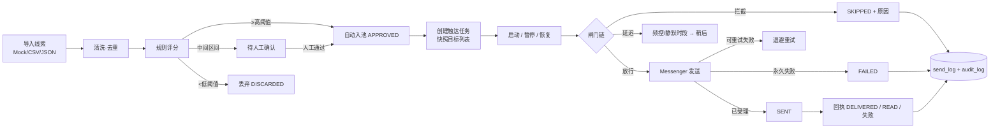

# 01 项目概览（Overview）

> 版本 v1.0 · 状态 定稿（2026-11-13 冻结）

## 1. 目标

按笔试题要求，做一个可演示的系统：检索并精确筛选 Instagram 上与"美容仪"相关的公开用户线索 → 对**已授权**的目标用户批量发送 WhatsApp 问候 → 完整记录任务执行过程与结果。全部在 Mock / 沙箱下运行，合规优先。

## 2. 范围

**范围内**：线索导入与清洗 · 去重 · 规则评分与阈值 / 人工确认 · 目标池 · 问候模板与个性化变量 · 批量任务（创建 / 执行 / 暂停 / 恢复 / 取消）· 发送闸门（退订 / 黑名单 / 授权 / 幂等 / 频控 / 静默时段）· 失败重试与退避 · 回执状态回写 · 审计与日志查询 · 脱敏 · 统计 · 配置管理 · 管理页与 REST API · Mock 数据与演示脚本 · 测试与文档。

**范围外（非目标）**：见 `00-constitution.md` §7。

## 3. 假设与平台事实（A-xx）

> 平台政策会变化。**写 README / 合规说明前，需对照 Meta 官方文档再核对一遍**，本节为设计依据而非权威引用。

- **A-1 号码来源**：Instagram 公开资料不含手机号，而 WhatsApp 发送必须有号码并以用户 opt-in 为前提。因此本系统约定：号码只来自"企业自有授权数据 / 用户主动留资"，在导入数据中体现为 `phone` + `consent_*` 字段。答辩时应主动说明这一点。
- **A-2 Instagram**：官方接口并不提供"按关键词搜索任意公开用户"的能力，且题目禁止非授权爬虫 → 采用 Mock 数据 + CSV/JSON 导入；`InstagramApiStub` 仅示意接口形态。
- **A-3 WhatsApp**：真实对接需要企业认证、已审核的消息模板，并遵循 opt-in 与退订要求 → 采用 `MockMessenger`；`WhatsAppCloudStub` 仅示意接口形态。
- **A-4 退订**：原型中一旦退订即永久拦截，不提供重新订阅流程（更保守、更安全）。
- **A-5 管理端**：单一管理员，使用静态 token 鉴权即可；不做账号体系。

## 4. 角色

| 角色 | 说明 |
|---|---|
| 运营人员 | 配置关键词 / 模板 / 频控；导入线索；审核；创建与控制任务；查看结果 |
| 系统 Worker | 进程内线程，按任务推进发送 |
| 外部 Provider | `LeadSource`（线索来源）与 `Messenger`（消息发送），均有 Mock 实现 |
| 终端用户（被触达者） | 可发送 `STOP` 退订；产生送达 / 已读回执 |

## 4.1 端到端主流程

## 5. 优先级定义

- **P0**：必做。构成演示与评分主路径。
- **P1**：应做。主路径之外的完善与加分项，进度落后时按 `plan.md` §5 裁剪。
- **P2**：可做。默认不做。

## 6. 需求追溯矩阵（题目 → 模块 → AC）

| 题目要求 | 模块 | 主要 AC |
|---|---|---|
| 配置美容仪相关关键词 | config / screening | CFG-001, SCR-002/003 |
| 采集或导入公开线索（用户名、简介、地区/语言、来源链接） | lead | LEAD-001/002/003/004/010 |
| 去重 | lead | LEAD-005/006/011 |
| 规则筛选、相关性评分 | screening | SCR-001 ~ 009 |
| 人工确认或阈值筛选 → 精确目标池 | screening / pool | SCR-010, POOL-001/002/003 |
| 基于目标池创建批量触达任务 | campaign | CAMP-001/002 |
| 问候模板及个性化变量 | template | TPL-001 ~ 008 |
| WhatsApp Business API 或沙箱模拟发送 | campaign / providers | CAMP-030/031 |
| 频控 | campaign / config | CAMP-012/013, CFG-002/008 |
| 黑名单、退订标记 | compliance | COMP-004/006/007/008/013 |
| 幂等控制 | campaign | CAMP-003/005/009/014 |
| 失败重试 | campaign | CAMP-015 ~ 019 |
| 发送状态回写 | campaign | CAMP-019/020/021 |
| 禁止对未授权 / 明确拒绝用户重复发送 | compliance / campaign | COMP-002/003/005/009, CAMP-011/014 |
| 记录：任务创建、目标列表、发送明细、成功/失败原因、重试次数、操作时间 | campaign / audit | CAMP-001/018/019, AUD-001/002 |
| 任务列表、任务详情、结果统计 | campaign / stats | CAMP-029, STAT-001 ~ 007 |
| 日志查询、审计追踪、敏感字段脱敏 | audit | AUD-005/006/007/008 |
| 管理界面或 API；任务创建 / 执行 / 暂停 / 结果查看 | api / ui | CAMP-004 ~ 008, UI-001 ~ 011 |
| 关键词、模板、频控规则等配置管理 | config / template | CFG-001/002/003, TPL-001/004 |
| 异常处理、重试、日志、基础测试 | cross-cutting | SYS-001, CAMP-015/016, AUD-008, `06-test-plan.md` |
| README、运行说明、AI 助手使用说明 | docs | tasks T-20, `docs/ai-usage.md` |

## 7. 交付物映射

| 题目交付物 | 对应产出 |
|---|---|
| 1 可运行代码仓库 | 本仓库 |
| 2 README（架构、运行、配置） | `README.md`（T-21，素材来自 `02-architecture.md`） |
| 3 数据模型与核心流程说明 | `03-data-model.md` + `02-architecture.md` 时序图（T-21 整理到 `docs/`） |
| 4 Mock 数据或沙箱演示 | `data/` + `scripts/demo.py`（`05-mock-data.md`） |
| 5 测试用例或测试说明 | `tests/` + AC 覆盖对照表（`06-test-plan.md`） |
| 6 合规与风险控制说明 | `docs/compliance-risk.md`（T-21，素材来自 `00-constitution.md`） |
| 7 10 分钟演示与答辩 | `docs/demo-script.md`（T-22） |

## 8. 术语表

| 术语 | 含义 |
|---|---|
| 线索（lead） | 一个 Instagram 公开账号的资料记录 |
| 目标池（pool） | `status=APPROVED` 的线索集合 |
| 授权（consent） | 号码持有人同意接收营销消息的记录，来源与凭证可追溯 |
| suppression | 黑名单（BLACKLIST）与退订（UNSUBSCRIBE）名单的统称 |
| 任务（campaign task） | 一次批量触达；创建时快照目标列表 |
| 明细（task item） | 任务中针对某个线索的一次触达单元；状态机在此级别 |
| 闸门（gate） | 发送前的一道检查；结果为放行 / 跳过（终态）/ 延迟（稍后重试） |
| 幂等键 | `sha256(task_id:lead_id:template_id)`；保证重复执行不重复发送 |
| 租约（lease） | Worker 认领明细时的临时锁；过期后可被回收 |
