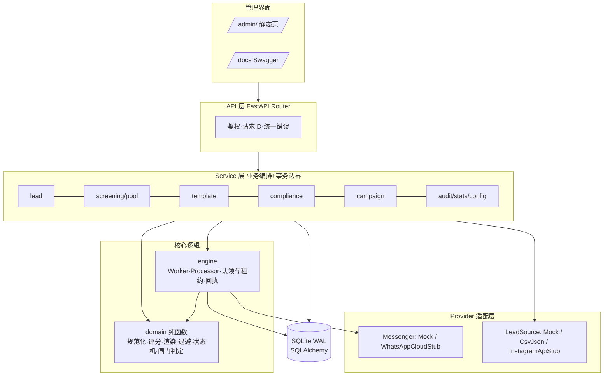
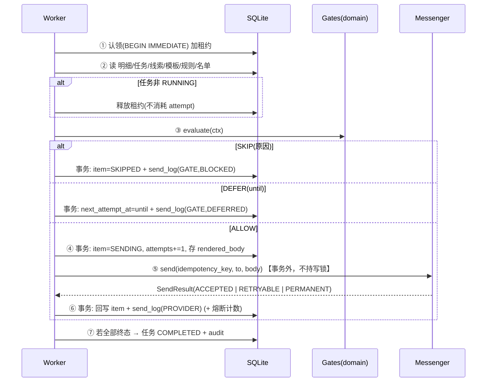

# 02 架构设计（Architecture）

> 版本 v1.0 · 状态 定稿（2026-11-13 冻结）

## 1. 总览：模块化单体 + 适配器隔离外部平台



**一句话**：一个进程、清晰分层；外部平台只通过 Provider 接口接入；"合规"和"可靠性"落在 `domain`（纯逻辑，易测）与 `engine`（发送引擎）里。

## 2. 分层与依赖规则

| 层 | 目录 | 职责 | 允许依赖 | 禁止 |
|---|---|---|---|---|
| API | `app/api/` | 路由、入参校验、鉴权、转换为 service 调用、错误映射 | schemas, services, core | 直接写 SQL / 业务判断 |
| Schemas | `app/schemas/` | Pydantic 请求 / 响应模型 | — | 业务逻辑 |
| Service | `app/services/` | 业务编排；**事务边界在这里**；写 audit | domain, repositories, providers, engine(部分) | 依赖 api |
| Domain | `app/domain/` | 纯函数 / 数据类：规范化、评分、模板渲染、退避、状态转换表、闸门判定 | 标准库 | FastAPI / SQLAlchemy / 网络 / 读时钟 |
| Engine | `app/engine/` | Worker 线程、认领 / 租约、单条明细处理、回执应用 | domain, repositories, providers | 依赖 api |
| Repository | `app/repositories/` | 查询与持久化（SQLAlchemy） | models | 业务规则 |
| Models | `app/models/` | ORM 模型、约束、触发器 DDL | — | — |
| Providers | `app/providers/` | `LeadSource`、`Messenger` 接口及实现 | domain | 依赖 services |
| Core | `app/core/` | 配置、DB、Clock、日志脱敏、安全（加解密 / HMAC）、错误 | — | — |

## 3. 目录结构

```
beauty-outreach/
├── AGENTS.md  README.md  pyproject.toml  .env.example
├── specs/                      # SDD：本目录
├── docs/                       # 交付文档：compliance-risk / ai-usage / demo-script / 架构图
├── app/
│   ├── main.py                 # 应用工厂、lifespan（启动 Worker）、静态页挂载
│   ├── core/                   # config.py db.py clock.py logging.py security.py errors.py
│   ├── models/                 # SQLAlchemy 模型（12 张表）+ triggers
│   ├── schemas/                # Pydantic 模型
│   ├── api/                    # leads.py pool.py templates.py compliance.py campaigns.py
│   │                           # config.py audit.py stats.py webhooks.py demo.py deps.py
│   ├── services/               # lead_service.py screening_service.py pool_service.py
│   │                           # template_service.py compliance_service.py campaign_service.py
│   │                           # config_service.py audit_service.py stats_service.py receipt_service.py
│   ├── repositories/
│   ├── domain/                 # normalize.py phone.py scoring.py render.py backoff.py
│   │                           # state.py gates.py masking.py
│   ├── engine/                 # worker.py processor.py claim.py
│   ├── providers/
│   │   ├── lead_source/        # base.py mock.py csv_json.py instagram_stub.py
│   │   └── messenger/          # base.py mock.py whatsapp_cloud_stub.py
│   └── static/                 # admin/index.html, admin/app/*.js, admin/style.css
├── data/                       # mock_leads.json  mock_consents.csv  mock_blacklist.csv  sample_leads.csv
├── scripts/                    # seed.py demo.py eval_screening.py ac_coverage.py
└── tests/
    ├── conftest.py             # FakeClock、临时库、socket 守卫、TestClient、假 Messenger
    ├── unit/  integration/  contract/  e2e/
```

## 4. 进程与线程模型

- **FastAPI 线程池**：处理 HTTP 请求。
- **Worker 线程（1 个）**：`lifespan` 启动，循环 `tick`（默认 1s）。每个 tick：
  1. 回收过期租约；
  2. 对每个 `RUNNING` 任务，原子认领最多 `claim_batch_size` 条可处理明细；
  3. 逐条交给 `Processor`；
  4. 轮询 Mock 回执并写回；
  5. 检查任务是否完成。
- 设置 `WORKER_ENABLED=false` 时不启动 Worker（测试里手动调用 `worker.tick()`，保证确定性）。
- **单 Worker 不变量**：频控计数与发送之间无并发竞争（INV：同一时刻只有一个线程调用 Messenger）。若将来扩多 Worker，需要把频控改为带锁的令牌桶——已知限制。

## 5. 核心时序：处理一条明细



**关键不变量**：
- 不在持有写事务时调用外部 Provider（避免长时间锁库）。
- 状态变更与对应日志在同一事务内（要么都成功要么都不发生）。
- 所有数据库事务（含只读）以 `BEGIN IMMEDIATE` 开始（`core/db.py` 事件钩子，Q-15），避免 WAL 下"先读后写"的快照过期错误，并保证审计哈希链读取"上一条哈希"与写入之间无并发插入；单进程原型接受读请求被串行化。
- 进程在 ⑤ 与 ⑥ 之间崩溃 → 重启后租约过期、明细被回收并**以同一幂等键重发**；Provider 对同键幂等 → 不产生第二条消息（至少一次投递 + 幂等 = 效果上恰好一次）。

## 6. 认领与租约

- 明细新增字段 `locked_by` / `locked_at`，**认领不改变业务状态**，只加租约；`SENDING` 仅在真正开始发送时设置。
- 可认领条件：`status IN (PENDING, RETRY_WAIT)` 且 `(next_attempt_at IS NULL OR next_attempt_at <= now)` 且 `(locked_at IS NULL OR locked_at < now - lease_seconds)` 且所属任务 `RUNNING`。
- 认领在 `BEGIN IMMEDIATE` 事务内完成（SQLite 写锁保证两个认领者不会拿到同一条）。
- 租约回收：`status=SENDING` 且租约过期 → 改为 `RETRY_WAIT`，`next_attempt_at=now`（`attempts` 已计数，因此仍受最大尝试次数约束）。
- 暂停：Processor 在 ③ 之前重读任务状态，非 `RUNNING` 则只清租约。

## 7. Provider 接口（契约）

```python
# app/providers/lead_source/base.py
@dataclass(frozen=True)
class RawLead:
    username: str; display_name: str | None; bio: str | None
    region: str | None; language: str | None; source_url: str | None
    phone: str | None; consent_status: str | None
    consent_source: str | None; consent_evidence: str | None

class LeadSource(Protocol):
    name: str
    def fetch(self) -> Iterable[RawLead | dict]: ...     # 逐行产出，行内错误由 service 处理

# app/providers/messenger/base.py
@dataclass(frozen=True)
class SendRequest:
    idempotency_key: str; to_phone: str   # E.164，仅内存中短暂存在
    body: str; template_name: str; language: str

class ResultKind(StrEnum): ACCEPTED="ACCEPTED"; RETRYABLE="RETRYABLE"; PERMANENT="PERMANENT"

@dataclass(frozen=True)
class SendResult:
    kind: ResultKind
    code: str | None            # 见 campaign.md §错误码分类
    message: str | None         # 必须不含号码（Processor 还会二次清洗）
    provider_message_id: str | None = None
    retry_after_seconds: float | None = None

class Messenger(Protocol):
    name: str
    def send(self, req: SendRequest) -> SendResult: ...
    def poll_receipts(self) -> list[Receipt]: ...         # 仅 Mock 有实际产出；真实实现返回 []
```

**契约测试**（`tests/contract/`）：同一套用例对 `MockMessenger` 与 `WhatsAppCloudStub` 运行——Stub 在 `enabled=false` 时必须抛 `ProviderNotEnabled`，且**不得发起任何网络调用**。

## 8. 错误模型

统一响应：

```json
{"error": {"code": "CAMPAIGN_INVALID_STATE", "message": "…", "request_id": "…", "details": {}}}
```

| code | HTTP | 说明 |
|---|---|---|
| VALIDATION_ERROR | 422 | 入参校验失败 |
| UNAUTHORIZED | 401 | 缺失 / 错误的 `X-Admin-Token` |
| SIGNATURE_INVALID | 401 | Webhook 签名错误 |
| NOT_FOUND | 404 | 资源不存在 |
| CONFLICT | 409 | 通用冲突 |
| CAMPAIGN_INVALID_STATE | 409 | 非法状态转换 |
| CAMPAIGN_EMPTY_TARGET | 422 | 目标列表为空 |
| TEMPLATE_NOT_APPROVED | 422 | 模板未审核通过 |
| TEMPLATE_IMMUTABLE | 409 | 已审核模板不可修改 |
| TEMPLATE_UNKNOWN_VARIABLE | 422 | 模板含未知变量 |
| COMP_UNSUBSCRIBE_IMMUTABLE | 409 | 退订记录不可删除 |
| CFG_LAST_RATE_RULE | 422 | 不能删除 / 禁用最后一条必需的频控规则 |
| LEAD_IMPORT_TOO_LARGE | 413 | 导入超限 |
| PROVIDER_NOT_ENABLED | 501 | 真实 Provider 未启用 |
| INTERNAL_ERROR | 500 | 未预期错误（响应不泄漏堆栈） |

## 9. 配置（`.env`）

| 变量 | 默认（`.env.example`） | 说明 |
|---|---|---|
| `DATABASE_URL` | `sqlite:///./data/app.db` | |
| `ADMIN_TOKEN` | `dev-admin-token` | 管理 API 鉴权 |
| `PHONE_ENC_KEY` | 开发用固定 Fernet key | 手机号加密；缺失则启动失败（CFG-007） |
| `PHONE_HASH_KEY` | 开发用固定字符串 | HMAC-SHA256 密钥 |
| `WEBHOOK_SECRET` | `dev-webhook-secret` | Webhook 签名 |
| `MESSENGER_PROVIDER` | `mock` | `mock` \| `whatsapp_cloud`（Stub，调用即 501） |
| `WORKER_ENABLED` | `true` | |
| `TICK_SECONDS` | `1` | |
| `DEMO_MODE` | `true` | 开启 `/demo/*` 辅助端点 |
| `LOG_LEVEL` | `INFO` | |

运行期可调参数（阈值、频控、重试、静默时段等）存数据库 `system_setting` / `rate_rule`，见 `modules/config-stats.md`。

## 10. 安全设计

- **鉴权**：`/api/v1/*` 需要 `X-Admin-Token`；操作人取自 `X-Operator`（默认 `admin`，格式受限），写入审计。Webhook 与 `/healthz` 例外：Webhook 用 HMAC 签名（`X-Hub-Signature-256: sha256=<hex>`，对原始请求体）。
- **手机号**：`phone_enc`（Fernet）+ `phone_hash`（HMAC-SHA256）+ `phone_masked`。解密只发生在发送前的内存中；不提供"查看完整号码"的 API。
- **UI 注入**：线索简介等来自外部，管理页一律用 `textContent` 渲染（UI-010）。
- **日志**：统一过滤器脱敏（AUD-008）；请求体不记录。

## 11. 关键设计决策记录（ADR）

| 编号 | 决策 | 备选 | 理由 |
|---|---|---|---|
| D-1 | 模块化单体 + SQLite | 微服务 / Postgres / Redis 队列 | 3 天原型，零外部依赖，演示稳定 |
| D-2 | DB 当任务队列，进程内单 Worker | Celery / RQ | 暂停 / 恢复 / 重启续跑都由 DB 状态决定，更易讲清也更易测 |
| D-3 | 状态机落在**明细级** | 任务级 | 重试、幂等、审计、统计都以明细为单位 |
| D-4 | 认领只加租约、不改业务状态 | 认领即置 SENDING | 暂停 / 释放不需要回滚状态 |
| D-5 | 手机号：加密 + 哈希 + 掩码 | 只存哈希 | 发送必须能还原号码；同时支持去重与脱敏展示 |
| D-6 | 先裁决"跳过"类闸门，再裁决"延迟"类闸门 | 任意顺序 | 不为注定被跳过的收件人占用频控额度 |
| D-7 | 频控 / 重试参数实时读取 | 任务创建时快照 | 运营可在运行中收紧限制；模板与目标仍是快照 |
| D-8 | 退订永久拦截，不做再订阅 | 做再订阅流程 | 更保守；范围更小 |
| D-9 | 规则评分默认且离线；LLM 评分不做 | LLM 打分 | 可复现、可解释、无网络依赖 |
| D-10 | 回执在 Mock 下由 `poll_receipts()` 产生；真实路径走签名 Webhook | 只做 Webhook | Mock 演示不依赖外部回调，同时保留真实形态 |

## 12. 已知限制与生产化路径

- SQLite 单写者 → 生产用 Postgres + 多 Worker + 行级锁 / `SKIP LOCKED`。
- 频控基于 `send_log` 计数 → 生产用令牌桶 / Redis。
- Mock 回执队列在内存，重启丢失 → 生产以 Webhook 为准。
- 无迁移工具；无细粒度权限；静态 token → 生产接入 SSO / RBAC。
- 手机号密钥在环境变量 → 生产用 KMS / 密钥轮换。
