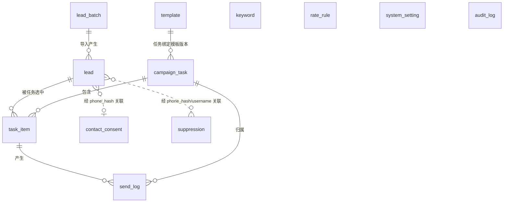
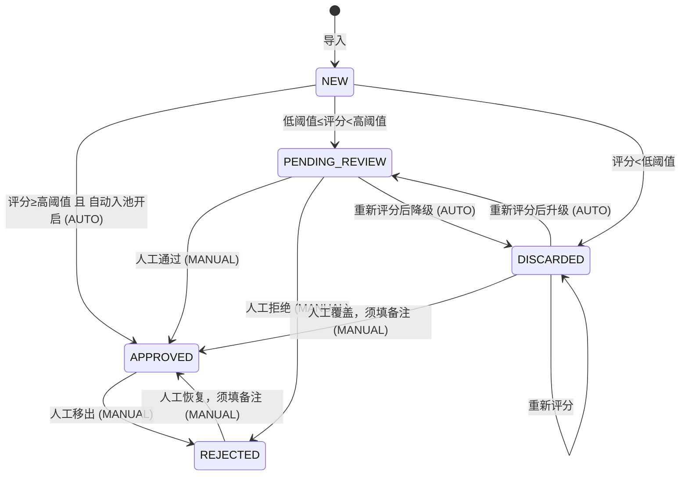
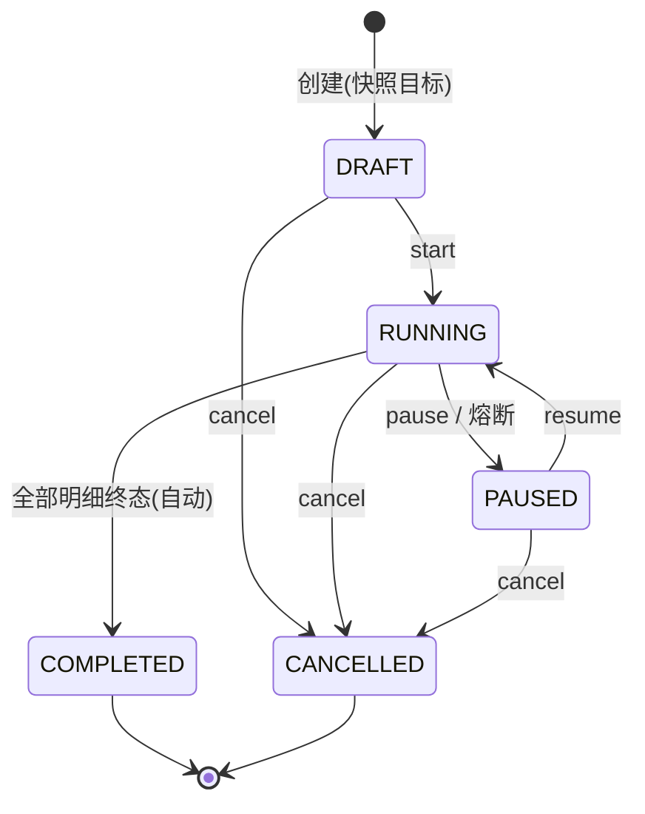
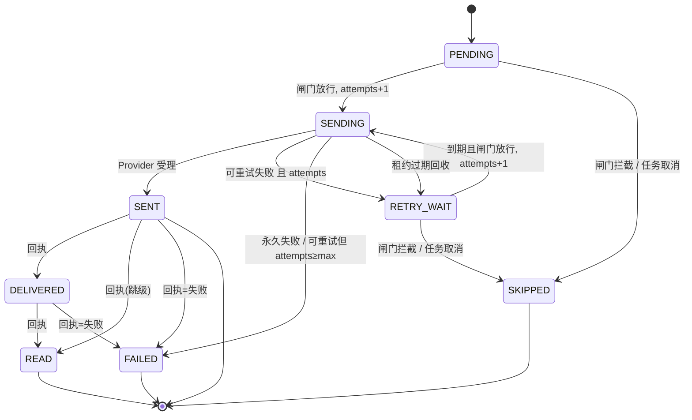

# 03 数据模型（Data Model）

> 版本 v1.0 · 状态 定稿（2026-11-13 冻结） · 共 12 张表。主键均为自增整数；时间为 UTC；JSON 列用 SQLite `JSON`（文本）。

## 1. ER 图



## 2. 表结构

### 2.1 `keyword`（关键词）
| 列 | 类型 | 约束 / 说明 |
|---|---|---|
| id | int PK | |
| term | text | 已规范化（NFKC、casefold、去首尾空白）；非空 |
| kind | text | `POSITIVE` \| `NEGATIVE` |
| weight | int | 1–50；正向加分 / 负向扣分的绝对值 |
| enabled | bool | 默认 true |
| created_at / updated_at | datetime | |
| | | **UNIQUE(term, kind)** |

### 2.2 `lead_batch`（导入批次）
| 列 | 类型 | 说明 |
|---|---|---|
| id | int PK | |
| source_type | text | `MOCK` \| `CSV` \| `JSON` \| `INSTAGRAM_API` |
| source_name | text | 文件名或数据源名 |
| total_rows / imported / duplicates / invalid / warnings | int | 计数 |
| errors | JSON | `[{row, code, detail}]`；`code` 见 `modules/lead.md` §错误码 |
| created_by | text | 操作人 |
| created_at | datetime | |

### 2.3 `lead`（线索）
| 列 | 类型 | 说明 |
|---|---|---|
| id | int PK | |
| batch_id | FK lead_batch | 首次导入的批次 |
| username | text | 规范化后；**UNIQUE** |
| display_name, bio | text null | |
| region | text null | 大写 ISO-3166 alpha-2，如 `US` |
| language | text null | 小写主语言子标签，如 `en` / `zh` |
| source_url | text null | 必须为 instagram.com 的 https 链接 |
| phone_enc | text null | Fernet 密文 |
| phone_hash | text null | HMAC-SHA256(hex)，索引 |
| phone_masked | text null | 如 `+861****5678` |
| status | text | `NEW` \| `PENDING_REVIEW` \| `APPROVED` \| `REJECTED` \| `DISCARDED` |
| score | int null | 0–100 |
| score_reasons | JSON null | `[{code, detail, delta}]` |
| top_keyword | text null | 得分最高的正向关键词（模板变量 `keyword`） |
| decision_source | text null | `AUTO` \| `MANUAL` |
| reviewed_by / reviewed_at / review_note | | 人工审核信息 |
| created_at / updated_at | datetime | |
| | | 索引：`(status, score)`、`phone_hash` |

### 2.4 `contact_consent`（授权）
| 列 | 类型 | 说明 |
|---|---|---|
| id | int PK | |
| phone_hash | text | **UNIQUE** |
| phone_masked | text | |
| status | text | `GRANTED` \| `REVOKED`（无记录 = UNKNOWN） |
| source | text | 非空：授权来源，如 `web_form`、`crm_import` |
| evidence_ref | text null | GRANTED 时必填：凭证引用（表单 ID、工单号等） |
| granted_at / updated_at | datetime | |
| updated_by | text | |

### 2.5 `suppression`（黑名单 / 退订）
| 列 | 类型 | 说明 |
|---|---|---|
| id | int PK | |
| type | text | `BLACKLIST` \| `UNSUBSCRIBE` |
| phone_hash | text null | |
| phone_masked | text null | |
| username | text null | |
| reason | text | |
| source | text | `MANUAL` \| `INBOUND_STOP` \| `IMPORT` |
| created_at | datetime | |
| created_by | text | |
| | | **CHECK**：`phone_hash` 与 `username` 至少一个非空 |
| | | **部分唯一索引**：`(type, phone_hash) WHERE phone_hash IS NOT NULL`；`(type, username) WHERE username IS NOT NULL` |

### 2.6 `template`（模板，版本化）
| 列 | 类型 | 说明 |
|---|---|---|
| id | int PK | |
| name | text | |
| version | int | 从 1 起 |
| language | text | |
| body | text | ≤ 800 字符（渲染后总长另受 1024 限制）；含 `{{var}}` / `{{var|默认}}` |
| status | text | `DRAFT` \| `APPROVED` \| `DISABLED` |
| created_by / approved_by | text | |
| approved_at / created_at | datetime | |
| | | **UNIQUE(name, version)**；APPROVED 后 body 不可变（服务层强制） |

### 2.7 `rate_rule`（频控规则）
| 列 | 类型 | 说明 |
|---|---|---|
| id | int PK | |
| name | text | |
| scope | text | `GLOBAL`（全局吞吐）\| `PER_RECIPIENT`（单收件人） |
| window_seconds | int | ≥ 1 |
| max_count | int | ≥ 1 |
| enabled | bool | |
| created_at / updated_at | datetime | |

### 2.8 `system_setting`（运行期设置）
| 列 | 类型 | 说明 |
|---|---|---|
| key | text PK | 必须在设置注册表内（`modules/config-stats.md` §3） |
| value | JSON | 类型由注册表校验 |
| updated_at / updated_by | | |

### 2.9 `campaign_task`（触达任务）
| 列 | 类型 | 说明 |
|---|---|---|
| id | int PK | |
| name | text | |
| template_id | FK template | 绑定到具体版本行 |
| status | text | `DRAFT` \| `RUNNING` \| `PAUSED` \| `COMPLETED` \| `CANCELLED` |
| selection | JSON | 创建时的筛选条件（审计用） |
| total_items | int | |
| pause_reason | text null | `MANUAL` \| `CIRCUIT_OPEN` |
| consecutive_failures | int | 熔断计数，默认 0 |
| created_by | text | |
| created_at / started_at / paused_at / finished_at / updated_at | datetime null | |

### 2.10 `task_item`（任务明细）
| 列 | 类型 | 说明 |
|---|---|---|
| id | int PK | |
| task_id | FK | |
| lead_id | FK | **UNIQUE(task_id, lead_id)** |
| idempotency_key | text | `sha256(f"{task_id}:{lead_id}:{template_id}")` hex；**UNIQUE** |
| phone_hash / phone_masked | text null | 创建时快照 |
| status | text | `PENDING` \| `SENDING` \| `RETRY_WAIT` \| `SENT` \| `DELIVERED` \| `READ` \| `FAILED` \| `SKIPPED` |
| reason_code | text null | 终态为 SKIPPED / FAILED 时的原因（见 `modules/campaign.md` §原因码） |
| attempts | int | 已发起的 Provider 调用次数，默认 0 |
| next_attempt_at | datetime null | 延迟 / 退避后的最早处理时间 |
| locked_by / locked_at | text / datetime null | 租约 |
| rendered_body | text null | 实际发送正文（**不进日志与审计**） |
| provider_message_id | text null | 索引 |
| last_error_code / last_error_message | text null | 已清洗，不含号码 |
| sent_at / delivered_at / read_at | datetime null | |
| created_at / updated_at | datetime | |
| | | 索引：`(task_id, status)`、`(status, next_attempt_at)`、`phone_hash`、`provider_message_id` |

### 2.11 `send_log`（发送与闸门日志，每次决策 / 调用一行）
| 列 | 类型 | 说明 |
|---|---|---|
| id | int PK | |
| task_id / item_id | FK | |
| phone_hash / phone_masked | text null | |
| phase | text | `GATE` \| `PROVIDER` \| `RECEIPT` |
| outcome | text | GATE：`BLOCKED` `DEFERRED`；PROVIDER：`ACCEPTED` `RETRYABLE_ERROR` `PERMANENT_ERROR`；RECEIPT：`DELIVERED` `READ` `DELIVERY_FAILED` |
| reason_code | text null | |
| attempt_no | int null | PROVIDER 阶段的第几次尝试 |
| provider_message_id | text null | |
| latency_ms | int null | |
| detail | JSON null | 如 `{"retry_at": "...", "delay_s": 4.2}` |
| created_at | datetime | |
| | | 索引：`item_id`、`(task_id, created_at)`、`(phone_hash, phase, outcome, created_at)` |

### 2.12 `audit_log`（审计，只追加）
| 列 | 类型 | 说明 |
|---|---|---|
| id | int PK | |
| ts | datetime | |
| actor | text | 操作人；系统动作为 `system:worker` / `system:webhook` |
| action | text | `<实体>_<动词>`，见 `modules/audit.md` §动作注册表 |
| entity_type / entity_id | text | |
| before / after | JSON null | **脱敏后**的快照（手机号只出现 masked） |
| request_id | text null | |
| prev_hash / hash | text null | 哈希链（AUD-004，P1） |
| | | 索引：`(entity_type, entity_id)`、`ts`；**触发器禁止 UPDATE / DELETE** |

```sql
CREATE TRIGGER audit_log_no_update BEFORE UPDATE ON audit_log
BEGIN SELECT RAISE(ABORT, 'audit_log is append-only'); END;
CREATE TRIGGER audit_log_no_delete BEFORE DELETE ON audit_log
BEGIN SELECT RAISE(ABORT, 'audit_log is append-only'); END;
```

## 3. 状态机

### 3.1 线索 `lead.status`

说明：人工产生的 `APPROVED` / `REJECTED` 不会被重新评分覆盖（SCR-012）；自动评分只作用于 `NEW` / `PENDING_REVIEW` / `DISCARDED`。

### 3.2 任务 `campaign_task.status`

`start` 对 `RUNNING` 再次调用 → 幂等无副作用；对其他非法状态 → 409。

### 3.3 明细 `task_item.status`

- 闸门"延迟"（频控 / 静默时段）：状态不变，仅更新 `next_attempt_at`，不增加 `attempts`。
- 终态：`SENT`（等待回执期间仍可前进）、`DELIVERED`、`READ`、`FAILED`、`SKIPPED`。
- **任务完成判定**：不存在 `PENDING` / `SENDING` / `RETRY_WAIT` 明细。

### 3.4 模板 `template.status`
`DRAFT → APPROVED → DISABLED`；`DRAFT` 可直接 `DISABLED`；`APPROVED` 的 body 不可改，修改 = 新建 `version+1`（`DRAFT`）。

## 4. 数据不变量（INV）

| 编号 | 不变量 | 保障方式 |
|---|---|---|
| INV-1 | 同一任务同一线索至多一条明细 | UNIQUE(task_id, lead_id) |
| INV-2 | 幂等键全局唯一 | UNIQUE(idempotency_key) |
| INV-3 | `audit_log` 不可改不可删 | 触发器 |
| INV-4 | 数据库中不存在明文手机号 | `phone_*` 列仅存密文 / 哈希 / 掩码；泄漏扫描测试 |
| INV-5 | 一个号码至多一条 consent 记录 | UNIQUE(phone_hash) |
| INV-6 | 同一 `(type, 标识)` 至多一条 suppression | 部分唯一索引 |
| INV-7 | `Σ 各状态明细数 = task.total_items` | 明细只在创建时生成，不删除 |
| INV-8 | `SENT/DELIVERED/READ` 明细必有 `provider_message_id` | 服务层 + 测试 |
| INV-9 | 终态 `SKIPPED`/`FAILED` 明细必有 `reason_code` | 服务层 + 测试 |
| INV-10 | 至少存在一条启用的 GLOBAL 和一条启用的 PER_RECIPIENT 规则 | CFG-008 |

## 5. 手机号处理规则

- 规范化：去空格 / 连字符，必须匹配 `^\+[1-9]\d{7,14}$`（E.164），否则视为无效。
- `phone_hash = HMAC_SHA256(PHONE_HASH_KEY, e164)`；`phone_enc = Fernet(PHONE_ENC_KEY).encrypt(e164)`。
- `phone_masked`：保留前 4 个字符（含 `+`）与后 4 位，中间替换为 `****`；总长 < 10 时只保留后 2 位。例：`+8613812345678` → `+861****5678`。
- 号码一经写入不可修改；同 username 再次导入但号码不同 → 保留原号码并记录冲突（LEAD-006）。

## 6. 保留与清理

原型不做自动清理；`/demo/reset`（仅 `DEMO_MODE`）清空并重新播种。生产应按数据最小化原则设置保留期（写入 `docs/compliance-risk.md`）。
